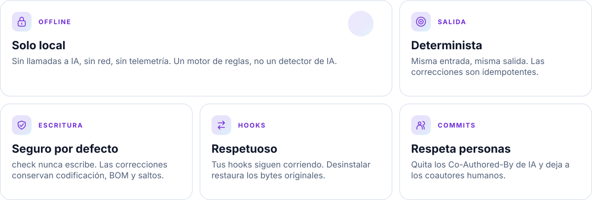

<a id="top"></a>

<div align="center">

<picture>
  <source media="(prefers-color-scheme: dark)" srcset="assets/readme/banner-es-dark.svg">
  
</picture>

<br/>


<!-- kit:nav -->
<p align="center"><a href="#-inicio-rápido-5-minutos"><picture><source media="(prefers-color-scheme: dark)" srcset="assets/readme-builder/kit/nav-es-01-dark.svg" /></picture></a>&nbsp;
<a href="#-instalación"><picture><source media="(prefers-color-scheme: dark)" srcset="assets/readme-builder/kit/nav-es-02-dark.svg" /></picture></a>&nbsp;
<a href="#-reglas"><picture><source media="(prefers-color-scheme: dark)" srcset="assets/readme-builder/kit/nav-es-03-dark.svg" /></picture></a>&nbsp;
<a href="#-hooks-de-git"><picture><source media="(prefers-color-scheme: dark)" srcset="assets/readme-builder/kit/nav-es-04-dark.svg" /></picture></a>&nbsp;
<a href="#-instalación-retirada-y-compatibilidad"><picture><source media="(prefers-color-scheme: dark)" srcset="assets/readme-builder/kit/nav-es-05-dark.svg" /></picture></a>&nbsp;
<a href="#-configuración"><picture><source media="(prefers-color-scheme: dark)" srcset="assets/readme-builder/kit/nav-es-06-dark.svg" /></picture></a>&nbsp;
<a href="README.md"><picture><source media="(prefers-color-scheme: dark)" srcset="assets/readme-builder/kit/nav-es-07-dark.svg" /></picture></a></p>
<!-- /kit:nav -->

</div>

<a id="-por-qué-reporinse"></a>
##  Por qué RepoRinse

<!-- kit:why -->
<p align="center"><picture><source media="(prefers-color-scheme: dark)" srcset="assets/readme-builder/kit/why-es-dark.svg" /></picture></p>
<!-- /kit:why -->

```text
feat: add parser                         feat: add parser

Co-Authored-By: Claude <noreply@…>   ─▶   Co-Authored-By: Ana <ana@example.com>
Co-Authored-By: Ana <ana@example.com>
```

<p align="center"><picture><source media="(prefers-color-scheme: dark)" srcset="assets/readme/diagrams/how-it-works-es-dark.svg" /></picture></p>

<p align="center"></p>

<a id="-instalación"></a>
##  Instalación

### Requisitos

| Herramienta | Versión | Para qué |
|---|---|---|
| [Rust](https://rustup.rs) | 1.88 o superior | Compilar el binario |
| Git | cualquiera reciente | Hooks y revisiones `--staged` |
| Python 3 | opcional | Solo para `scripts/package.py` (paquete offline) |

### Opción A — Compilar desde el código (recomendada)

**1. Clona y compila**

```sh
git clone https://github.com/robgallardof/RepoRinse.git
cd RepoRinse
cargo build --release --locked
```

El binario queda en:

- Linux / macOS: `target/release/reporinse`
- Windows: `target\release\reporinse.exe`

**2. Ponlo en tu `PATH`** (elige tu sistema)

<details open>
<summary><b>Linux / macOS</b></summary>

```sh
sh installers/install.sh target/release/reporinse
# lo instala en ~/.local/bin/reporinse — agrega esa carpeta al PATH si aún no está:
echo 'export PATH="$HOME/.local/bin:$PATH"' >> ~/.bashrc   # o ~/.zshrc
```

El instalador acepta dos argumentos opcionales: `install.sh [binario] [destino]`. Nunca modifica tus archivos de
inicio de shell; el `echo` de arriba lo decides tú.

</details>

<details open>
<summary><b>Windows (PowerShell 7)</b></summary>

```powershell
pwsh installers/install.ps1 -Binary target\release\reporinse.exe -AddToPath
# lo instala en %LOCALAPPDATA%\RepoRinse\bin y lo agrega al PATH de tu usuario
```

Abre una terminal nueva para que tome el `PATH` actualizado. Usa `-Destination <carpeta>` para instalar en otro lugar.

</details>

**3. Comprueba que funciona**

```sh
reporinse --version
reporinse modules list
```

> [!IMPORTANT]
> Deja el binario en una **ruta estable**. Los hooks guardan su ruta absoluta al instalarse. Si lo mueves, usan
> `reporinse` del `PATH`; si tampoco existe, omiten sus revisiones (nunca bloquean tu commit). Vuelve a ejecutar
> `reporinse install …` después de moverlo.

> [!TIP]
> **¿Vienes de [no-ai-coauthor](https://github.com/robgallardof/no-ai-couathor)?** RepoRinse es su sucesor.
> Sigue la [guía de migración](docs/migration/no-ai-couathor.md#español): el hook anterior sigue funcionando hasta que lo retires.

### Opción B — Paquete offline

Genera un `.zip` (Windows) o `.tar.gz` (Linux/macOS) portable con su checksum SHA-256:

```sh
python scripts/package.py          # crea dist/reporinse-<versión>-<so>-<arq>.{zip|tar.gz} + .sha256
```

Copia el paquete al otro equipo, verifica el checksum, descomprímelo y usa el instalador que trae dentro:

```sh
sha256sum -c reporinse-*.sha256             # Linux/macOS
sh installers/install.sh                    # usa ../reporinse del paquete por defecto
```

```powershell
Get-FileHash .\reporinse-*.zip -Algorithm SHA256   # compáralo con el archivo .sha256
pwsh .\installers\install.ps1 -AddToPath
```

### Opción C — Docker (opcional)

Para CI o equipos sin Rust: la imagen ejecuta `check` y `fix` sobre un repositorio montado en `/repo` (sin root y sin
red). Los hooks de Git y las integraciones de agentes se instalan de forma nativa con las opciones A/B, porque un hook
instalado desde un contenedor apuntaría a una ruta que solo existe dentro de él.

```sh
docker build -t reporinse:local .
docker run --rm --network none -v "$PWD:/repo" reporinse:local check --staged
docker run --rm --network none -v "$PWD:/repo" reporinse:local fix --message .git/COMMIT_EDITMSG
REPORINSE_REPO=/ruta/al/repo docker compose run --rm reporinse check --files README.md
```

En Linux agrega `--user "$(id -u):$(id -g)"` (Compose: `REPORINSE_USER`) para que los arreglos conserven tu dueño de
archivos. Detalles: [docs/DOCKER.md](docs/DOCKER.md) (en inglés).

Verifica la imagen y Compose reales con `python scripts/test_docker.py`.
Usa un repositorio temporal y comprueba el índice y la corrección de mensajes sin instalar hooks en tu equipo.

<p align="center"></p>

<a id="-inicio-rápido-5-minutos"></a>
##  Inicio rápido (5 minutos)

Dentro de cualquier repositorio Git:

```sh
# 1. Crea un archivo de configuración comentado (.reporinse.toml) en la raíz
reporinse init

# 2. Busca problemas — esto nunca modifica nada
reporinse check --staged

# 3. Instala los hooks de Git (primero vista previa, luego de verdad)
reporinse install --provider git --all --dry-run
reporinse install --provider git --all --yes

# 4. Confirma que todo quedó bien
reporinse status
reporinse doctor
```

A partir de ahora, cada `git commit` quita del mensaje los trailers de coautoría de IA conocidos y revisa los
archivos preparados (staged).

<p align="center"></p>

<a id="-reglas"></a>
##  Reglas

| Regla | Por defecto | Qué hace |
|---|:---:|---|
| `git.ai-attribution` | `fix` | Quita trailers `Co-Authored-By` y pies "Generated with" de agentes de IA conocidos; conserva humanos |
| `text.whitespace` | `warn` | Espacios/tabs al final de línea; respeta saltos duros de Markdown y EditorConfig |
| `text.invisible-unicode` | `warn` | Reporta controles bidi, espacios de ancho cero y BOM incrustados (nunca los borra) |
| `docs.agent-artifacts` | `warn` | Revisa Markdown de planes/resúmenes recién añadidos fuera de carpetas de docs; nunca borra |
| `git.diff-scope` | `warn` | Avisa de cambios con más de 25 archivos o 500 líneas (configurable) |
| `git.dependency-watch` | `warn` | Avisa de cambios en manifiestos de dependencias y lockfiles |
| `code.duplicate-comments` | `off` | Opcional: comentarios de línea idénticos y consecutivos |
| `agent.command-guard` | `warn` | Comandos de agentes que coinciden con tus patrones `deny` (sin patrones no coincide nada) |
| `agent.path-scope` | `warn` | Rutas de agentes que coinciden con tus patrones `deny` (sin patrones no coincide nada) |

**Modos** — cada regla acepta uno:

| Modo | Efecto |
|---|---|
| `off` | La regla no se ejecuta |
| `warn` | Reporta el hallazgo; el código de salida sigue en `0` |
| `block` | Reporta y falla (salida `1`): detiene un commit o veta una acción del agente |
| `fix` | Aplica la corrección segura y determinista (solo si la regla la soporta) |

Consulta cualquier regla desde la terminal:

```sh
reporinse modules info git.ai-attribution    # metadatos: modos, objetivos, riesgo
reporinse rule explain text.whitespace        # documentación completa con ejemplos
```

La documentación de cada regla está en [`docs/rules/`](docs/rules/).

<p align="center"></p>

<a id="-revisar"></a>
##  Revisar

`check` **nunca escribe**. Elige una entrada:

```sh
reporinse check --staged                     # lo que vas a commitear (contenido del índice)
reporinse check --files src/main.rs README.md
reporinse check --message .git/COMMIT_EDITMSG
reporinse check --staged --only text.whitespace,text.invisible-unicode
```

Opciones globales útiles: `--json` (salida estructurada), `--quiet` (solo bloqueos), `--verbose`, `--no-color`.

### Códigos de salida

| Código | Significado |
|:---:|---|
| `0` | Éxito o solo advertencias |
| `1` | Coincidió una regla en modo `block` |
| `2` | Error de uso (opción inválida, regla desconocida) |
| `3` | Error de configuración |
| `4` | Conflicto (p. ej. el archivo cambió desde el análisis, `core.hooksPath` global) |

<p align="center"></p>

<a id="-corregir"></a>
##  Corregir

Las correcciones solo se aplican a reglas que pongas explícitamente en `mode = "fix"` (`git.ai-attribution` ya
viene en `fix`).

**1. Activa la corrección** en `.reporinse.toml`:

```toml
[rules."text.whitespace"]
mode = "fix"
honor_editorconfig = true
```

**2. Revisa y aplica:**

```sh
reporinse fix --files src/main.rs --dry-run   # muestra el diff, no escribe
reporinse fix --files src/main.rs

reporinse fix --staged --dry-run              # contenido staged: corrige índice y árbol de trabajo a la vez
reporinse fix --staged

reporinse fix --message .git/COMMIT_EDITMSG   # limpia un archivo de mensaje de commit
```

<details>
<summary><b>Qué garantiza el corrector</b></summary>

- `--staged` solo toca líneas añadidas/modificadas; `--files` usa el archivo completo.
- Se conservan BOM, saltos de línea (LF/CRLF) y el salto final.
- `trim_trailing_whitespace = false` en EditorConfig desactiva la limpieza en esos archivos; en modo staged se lee
  el `.editorconfig` preparado.
- `--staged` rechaza archivos parcialmente preparados y diferencias de codificación, toma el lock del índice de Git
  y trabaja con un índice temporal.
- Se rechazan: binarios, archivos de más de 8 MiB, enlaces simbólicos/reparse points, rutas fuera del repositorio y
  archivos que cambiaron desde el análisis.
- Los hooks de Git **nunca** modifican archivos preparados, solo el mensaje del commit.
- Evita editar los mismos archivos al mismo tiempo: los editores normales no respetan el lock del índice.

</details>

<p align="center"></p>

<a id="-hooks-de-git"></a>
##  Hooks de Git

### Qué se instala

| Hook | Cuándo corre | Qué hace |
|---|---|---|
| `commit-msg` | `git commit`, `--amend`, merges, pasos de rebase | Limpia el mensaje (quita trailers de IA), conserva saltos de línea y BOM, muestra qué cambió |
| `pre-commit` | antes de cada commit | Revisa el contenido **preparado**; nunca modifica archivos. Solo falla si una regla está en `block` |

Cada hook es un pequeño script POSIX `sh` que llama a `reporinse hook git <hook>`.

### Paso a paso — un repositorio

```sh
cd mi-proyecto

# 1. Mira exactamente qué se va a escribir
reporinse install --provider git --all --dry-run

# 2. Instala
reporinse install --provider git --all --yes

# 3. Verifica
reporinse status          # → git (Repo): installed
reporinse doctor          # → No configuration or installed-hook problems found.
```

Archivos creados: `.git/hooks/commit-msg`, `.git/hooks/pre-commit` y un manifest en
`.git/reporinse/git-manifest.json`.

### Paso a paso — todos los repositorios de tu equipo

```sh
reporinse install --provider git --scope user --all --dry-run
reporinse install --provider git --scope user --all --yes
```

Esto crea una carpeta `git-hooks` dentro de la carpeta de configuración de usuario de RepoRinse
(`~/.config/reporinse`, o `%APPDATA%\reporinse` en Windows — ver [Configuración](#-configuraci%C3%B3n)) y apunta
`git config --global core.hooksPath` a ella.
El `.git/hooks/<hook>` propio de cada repositorio sigue ejecutándose primero.

### Instalar solo algunas reglas

```sh
reporinse install --provider git --only git.ai-attribution --yes      # solo limpiar mensajes de commit
reporinse install --provider git --all --except git.diff-scope --yes  # todo menos una
reporinse install --provider git --interactive                        # elegir en la terminal
```

### Pruébalo

```sh
git commit -m "feat: x" -m "Co-Authored-By: Claude <noreply@anthropic.com>"
# reporinse: removed: line 3: AI co-author trailer: Claude <noreply@anthropic.com> [git.ai-attribution]
git log -1 --format=%B    # el trailer ya no está
```

### Desinstalar

```sh
reporinse uninstall --provider git --all --yes                 # alcance repo
reporinse uninstall --provider git --scope user --all --yes    # alcance usuario
```

<details>
<summary><b>Cómo convive con otros hooks (Husky, pre-commit, lefthook…)</b></summary>

- Un hook existente se renombra a `<hook>.reporinse-chained` y **corre primero**, con los mismos argumentos y
  stdin. Si falla, el commit se detiene y RepoRinse no hace nada.
- RepoRinse **nunca establece, cambia ni borra** un `core.hooksPath` existente. Si viene de tu configuración global,
  la instalación por repositorio se rechaza (salida `4`) en lugar de afectar a todos tus repositorios.
- Los problemas de configuración o E/S **no bloquean**: el hook muestra el problema y deja pasar el commit. Solo las
  reglas en modo `block` pueden fallar un commit.
- La desinstalación restaura el hook original byte por byte y se niega si el script fue editado (usa `--force`
  después de revisar el cambio).

Detalles completos: [docs/integrations/git.md](docs/integrations/git.md).

</details>

<p align="center"></p>

<a id="-instalación-retirada-y-compatibilidad"></a>
<a id="-hooks-de-agentes-claude-codex-gemini-cursor"></a>
##  Instalación, retirada y compatibilidad

RepoRinse se conecta a los sistemas de hooks nativos de los agentes de código para **avisar o bloquear** los
comandos y rutas que pongas en tu política.

### Proveedores soportados

Todos los proveedores se instalan y se quitan con los mismos dos comandos; `--dry-run` muestra el plan antes y
`--scope user` escribe en tu carpeta personal en vez del repositorio.

| Proveedor | `--provider` | Eventos | Archivo (alcance repo) | Quitar | Verificado |
|---|---|---|---|---|---|
| Claude Code | `claude` | PreToolUse, PostToolUse | `.claude/settings.json` | `uninstall --provider claude --all --yes` | Los handlers generados corren en pruebas |
| Codex | `codex` | PreToolUse, PostToolUse | `.codex/hooks.json` | `uninstall --provider codex --all --yes` | Los handlers corren en pruebas; confírmalos en `/hooks` |
| Gemini CLI | `gemini` | BeforeTool, AfterTool | `.gemini/settings.json` | `uninstall --provider gemini --all --yes` | Los handlers generados corren en pruebas |
| Cursor | `cursor` | beforeShellExecution, beforeReadFile, afterFileEdit | `.cursor/hooks.json` | `uninstall --provider cursor --all --yes` | Los handlers generados corren en pruebas |
| OpenCode 1.x | `opencode` | tool.execute.before, tool.execute.after | `.opencode/plugins/reporinse.js` | `uninstall --provider opencode --all --yes` | Hecho para la API de plugins 1.19.4 |
| DeepSeek Harness | `deepseek` | tools/pre-execute | `.dsh/reporinse.cordis.yml` | `uninstall --provider deepseek --all --yes` | Hecho para 0.2.1-rc.2 |
| Antigravity | — | Solo hooks de Git | — | — | Sin hooks nativos |

Todavía no se afirma ninguna sesión real dentro de Claude, Codex, Gemini o Cursor; la confianza de hooks y los
tiempos de espera del host faltan por probar en las apps reales ([notas de verificación](docs/development/verification.md)).

### OpenCode y DeepSeek Harness

Puedes añadir guardas antes de ejecutar herramientas en estos agentes. Los puentes son optativos y se instalan solo en este proyecto.

```sh
reporinse install --provider opencode,deepseek --all --dry-run
reporinse install --provider opencode,deepseek --all --yes
```

Para DeepSeek, inicia el agente con `dsh web --patch .dsh/reporinse.cordis.yml`. OpenCode carga su plugin al abrir el proyecto.

[Guía de instalación y límites](docs/integrations/opencode-deepseek.md).

Con `--scope user` se escriben los mismos archivos en tu carpeta personal (Claude respeta `CLAUDE_CONFIG_DIR` y
Codex respeta `CODEX_HOME`).

### Paso a paso

**1. Escribe una política.** Sin patrones no coincide nada. En `.reporinse.toml`:

```toml
[rules."agent.command-guard"]
mode = "block"                                   # warn = solo avisar, block = vetar la acción
deny = ["*git reset --hard*", "*git push --force*", "*rm -rf*"]

[rules."agent.path-scope"]
mode = "block"
deny = [".env", "**/.env", ".git/**", "**/.git/**"]
```

**2. Valídala:**

```sh
reporinse config validate
```

**3. Revisa e instala** para el o los agentes que uses:

```sh
reporinse install --provider claude --all --dry-run
reporinse install --provider claude --all --yes

# varios a la vez
reporinse install --provider claude,codex,gemini --all --yes
```

**4. Recarga el agente** (ver la tabla) y comprueba:

```sh
reporinse status          # → claude (Repo): installed
```

Cuando el agente intente un comando que coincida, la acción se rechaza antes de ejecutarse con un mensaje como
`agent.command-guard: configured policy matched`.

**5. Desinstala** cuando quieras; los ajustes previos se restauran exactamente:

```sh
reporinse uninstall --provider claude,codex,gemini,cursor --all --yes
```

> [!NOTE]
> Cursor también puede cargar los hooks de Claude. Instala solo uno de los dos para las mismas reglas y así evitar
> que se ejecuten dos veces.

<details>
<summary><b>Garantías de seguridad y límites</b></summary>

- Tus ajustes y hooks de agentes se **combinan**, no se reemplazan. Un manifest guarda los bytes originales y la
  desinstalación se niega si el archivo cambió (revísalo antes de usar `--force`).
- Varios proveedores se verifican juntos antes de escribir; cada uno revierte sus propias escrituras fallidas.
- Los adaptadores **nunca aprueban automáticamente** acciones, reintentan turnos ni ocultan resultados. El bloqueo
  solo aplica antes de una acción; los eventos posteriores solo avisan.
- Entrada o configuración inválida **no bloquea** y muestra un mensaje saneado (sin comandos, rutas ni código).
  La entrada está limitada a 1 MiB.
- Los patrones son texto simple, no un intérprete de shell. Complementan — nunca sustituyen — las aprobaciones y el
  sandbox del propio agente.
- El adaptador de Claude también deja vacías las cadenas de atribución de commits/PR en sus ajustes (se restauran al
  desinstalar).


</details>

<!-- kit:agent-links -->
<p align="center"><a href="docs/research/compatibility-matrix.md"><picture><source media="(prefers-color-scheme: dark)" srcset="assets/readme-builder/kit/agent-links-es-01-dark.svg" /></picture></a>&nbsp;
<a href="docs/integrations/claude.md"><picture><source media="(prefers-color-scheme: dark)" srcset="assets/readme-builder/kit/agent-links-es-02-dark.svg" /></picture></a>&nbsp;
<a href="docs/integrations/codex.md"><picture><source media="(prefers-color-scheme: dark)" srcset="assets/readme-builder/kit/agent-links-es-03-dark.svg" /></picture></a>&nbsp;
<a href="docs/integrations/gemini.md"><picture><source media="(prefers-color-scheme: dark)" srcset="assets/readme-builder/kit/agent-links-es-04-dark.svg" /></picture></a>&nbsp;
<a href="docs/integrations/cursor.md"><picture><source media="(prefers-color-scheme: dark)" srcset="assets/readme-builder/kit/agent-links-es-05-dark.svg" /></picture></a>&nbsp;
<a href="docs/integrations/opencode-deepseek.md"><picture><source media="(prefers-color-scheme: dark)" srcset="assets/readme-builder/kit/agent-links-es-06-dark.svg" /></picture></a></p>
<!-- /kit:agent-links -->

<p align="center"></p>

<a id="-configuración"></a>
##  Configuración

`reporinse init` crea `.reporinse.toml` en la raíz del repositorio. Presets: `minimal`, `balanced` (por defecto),
`strict`, `custom`.

```sh
reporinse init --preset strict
reporinse init --force               # sobrescribe un archivo existente
```

Un ejemplo completo (ver [`examples/.reporinse.toml`](examples/.reporinse.toml)):

```toml
version = 1
preset = "balanced"
exclude = ["**/node_modules/**", "**/target/**", "**/dist/**", "vendor/**"]

[providers]
git = true

[rules."git.ai-attribution"]
mode = "fix"

[rules."text.whitespace"]
mode = "warn"
honor_editorconfig = true
exclude = ["docs/legacy/**"]

[rules."git.diff-scope"]
mode = "warn"
max_files = 25
max_lines = 500
```

**De dónde sale la configuración** (mayor prioridad primero):

1. Opciones de la CLI
2. Repositorio: `<raíz>/.reporinse.toml`
3. Usuario: `$REPORINSE_CONFIG_HOME/config.toml` → `$XDG_CONFIG_HOME/reporinse/config.toml` →
   `%APPDATA%\reporinse\config.toml` (Windows) → `~/.config/reporinse/config.toml`
4. Preset
5. Valores incorporados

```sh
reporinse config validate     # claves, reglas o modos desconocidos son errores (salida 3)
reporinse config explain      # cada valor efectivo y de dónde viene
```

Referencia completa: [docs/configuration/README.md](docs/configuration/README.md).

<p align="center"></p>

<a id="-solución-de-problemas"></a>
##  Solución de problemas

| Síntoma | Qué hacer |
|---|---|
| El hook no hace nada | `reporinse doctor`: revisa `core.hooksPath`, hooks ajenos, cambios y proveedores faltantes |
| `binary not found` al hacer commit | El binario se movió. Ponlo en el `PATH` o vuelve a ejecutar `reporinse install` |
| Instalación rechazada con salida `4` | `core.hooksPath` está definido globalmente: usa `--scope user` o quítalo tú |
| La desinstalación se niega (drift) | Un archivo cambió tras instalar. Revísalo y luego `uninstall … --force` |
| No sabes qué hizo una regla | `reporinse rule explain <id>` o `reporinse check --verbose` |
| Lo necesitas en CI / scripts | Añade `--json` y usa los códigos de salida |

<p align="center"></p>

<a id="-desarrollo"></a>
##  Desarrollo

```sh
cargo build
cargo fmt --check
cargo clippy --locked --all-targets -- -D warnings
cargo test --locked                  # sin red; Git y ajustes de agentes aislados en carpetas temporales
python scripts/package.py            # paquete offline
python scripts/test_docker.py        # imagen Docker opcional, prueba con contenedor real
```

La CI corre en Windows, Linux y macOS. Antes de contribuir lee [AGENTS.md](AGENTS.md) y
[CONTRIBUTING.md](CONTRIBUTING.md). Qué está verificado y qué no:
[docs/development/verification.md](docs/development/verification.md).

<p align="center"></p>

<a id="-más"></a>
##  Más

<!-- kit:more -->
<p align="center"><a href="docs/configuration/README.md"><picture><source media="(prefers-color-scheme: dark)" srcset="assets/readme-builder/kit/more-es-01-dark.svg" /></picture></a>&nbsp;
<a href="docs/rules/"><picture><source media="(prefers-color-scheme: dark)" srcset="assets/readme-builder/kit/more-es-02-dark.svg" /></picture></a>&nbsp;
<a href="docs/integrations/"><picture><source media="(prefers-color-scheme: dark)" srcset="assets/readme-builder/kit/more-es-03-dark.svg" /></picture></a>&nbsp;
<a href="SECURITY.md"><picture><source media="(prefers-color-scheme: dark)" srcset="assets/readme-builder/kit/more-es-04-dark.svg" /></picture></a>&nbsp;
<a href="CHANGELOG.md"><picture><source media="(prefers-color-scheme: dark)" srcset="assets/readme-builder/kit/more-es-05-dark.svg" /></picture></a>&nbsp;
<a href="LICENSE"><picture><source media="(prefers-color-scheme: dark)" srcset="assets/readme-builder/kit/more-es-06-dark.svg" /></picture></a></p>
<!-- /kit:more -->

<br/>

<p align="center"><a href="#top"><picture><source media="(prefers-color-scheme: dark)" srcset="assets/readme-builder/kit/btn-volver-al-inicio-outline-sm-dark.svg" /></picture></a></p>

<!-- readme-builder:signature:start -->
<p align="center"><a href="https://github.com/robgallardof"><picture><source media="(prefers-color-scheme: dark)" srcset="assets/readme/brand/signature-es-dark.svg" /></picture></a></p>
<!-- readme-builder:signature:end -->
