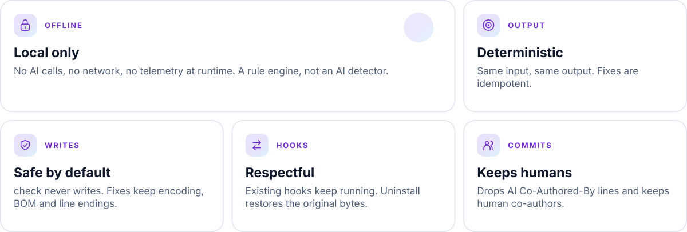

<a id="top"></a>

<div align="center">

<picture>
  <source media="(prefers-color-scheme: dark)" srcset="assets/readme/banner-en-dark.svg">
  
</picture>

<br/>


<!-- kit:nav -->
<p align="center"><a href="#-quick-start-5-minutes"><picture><source media="(prefers-color-scheme: dark)" srcset="assets/readme-builder/kit/nav-en-01-dark.svg" /></picture></a>&nbsp;
<a href="#-install"><picture><source media="(prefers-color-scheme: dark)" srcset="assets/readme-builder/kit/nav-en-02-dark.svg" /></picture></a>&nbsp;
<a href="#-rules"><picture><source media="(prefers-color-scheme: dark)" srcset="assets/readme-builder/kit/nav-en-03-dark.svg" /></picture></a>&nbsp;
<a href="#-git-hooks"><picture><source media="(prefers-color-scheme: dark)" srcset="assets/readme-builder/kit/nav-en-04-dark.svg" /></picture></a>&nbsp;
<a href="#-agent-setup-removal-and-compatibility"><picture><source media="(prefers-color-scheme: dark)" srcset="assets/readme-builder/kit/nav-en-05-dark.svg" /></picture></a>&nbsp;
<a href="#-configuration"><picture><source media="(prefers-color-scheme: dark)" srcset="assets/readme-builder/kit/nav-en-06-dark.svg" /></picture></a>&nbsp;
<a href="README.es.md"><picture><source media="(prefers-color-scheme: dark)" srcset="assets/readme-builder/kit/nav-en-07-dark.svg" /></picture></a></p>
<!-- /kit:nav -->

</div>

<a id="-why-reporinse"></a>
##  Why RepoRinse

<!-- kit:why -->
<p align="center"><picture><source media="(prefers-color-scheme: dark)" srcset="assets/readme-builder/kit/why-en-dark.svg" /></picture></p>
<!-- /kit:why -->

```text
feat: add parser                         feat: add parser

Co-Authored-By: Claude <noreply@…>   ─▶   Co-Authored-By: Ana <ana@example.com>
Co-Authored-By: Ana <ana@example.com>
```

<p align="center"><picture><source media="(prefers-color-scheme: dark)" srcset="assets/readme/diagrams/how-it-works-en-dark.svg" /></picture></p>

<p align="center"></p>

<a id="-install"></a>
##  Install

### Requirements

| Tool | Version | Needed for |
|---|---|---|
| [Rust](https://rustup.rs) | 1.88 or newer | Building the binary |
| Git | any recent | Hooks and `--staged` checks |
| Python 3 | optional | Only for `scripts/package.py` (offline archive) |

### Option A — Build from source (recommended)

**1. Clone and build**

```sh
git clone https://github.com/robgallardof/RepoRinse.git
cd RepoRinse
cargo build --release --locked
```

The binary is created at:

- Linux / macOS: `target/release/reporinse`
- Windows: `target\release\reporinse.exe`

**2. Put it on your `PATH`** (pick your system)

<details open>
<summary><b>Linux / macOS</b></summary>

```sh
sh installers/install.sh target/release/reporinse
# installs to ~/.local/bin/reporinse — add that folder to PATH if it is not already there:
echo 'export PATH="$HOME/.local/bin:$PATH"' >> ~/.bashrc   # or ~/.zshrc
```

The installer takes two optional arguments: `install.sh [binary] [destination]`. It never edits your shell
startup files — the `echo` above is up to you.

</details>

<details open>
<summary><b>Windows (PowerShell 7)</b></summary>

```powershell
pwsh installers/install.ps1 -Binary target\release\reporinse.exe -AddToPath
# installs to %LOCALAPPDATA%\RepoRinse\bin and adds it to your user PATH
```

Open a new terminal afterwards so the new `PATH` is picked up. Use `-Destination <folder>` to install elsewhere.

</details>

**3. Check it works**

```sh
reporinse --version
reporinse modules list
```

> [!IMPORTANT]
> Keep the binary at a **stable path**. Hooks record its absolute location at install time. If you move it,
> the hooks fall back to `reporinse` on `PATH`; if that is missing they skip their checks (they never block your
> commit). Re-run `reporinse install …` after moving it.

> [!TIP]
> **Coming from [no-ai-coauthor](https://github.com/robgallardof/no-ai-couathor)?** RepoRinse is its successor.
> Follow the [migration guide](docs/migration/no-ai-couathor.md) — the old hook keeps working until you retire it.

### Option B — Offline archive

Build a portable `.zip` (Windows) or `.tar.gz` (Linux/macOS) with a SHA-256 checksum:

```sh
python scripts/package.py          # writes dist/reporinse-<version>-<os>-<arch>.{zip|tar.gz} + .sha256
```

Copy the archive to the target machine, verify the checksum, extract it and run the installer included inside:

```sh
sha256sum -c reporinse-*.sha256             # Linux/macOS
sh installers/install.sh                    # uses ../reporinse from the archive by default
```

```powershell
Get-FileHash .\reporinse-*.zip -Algorithm SHA256   # compare with the .sha256 file
pwsh .\installers\install.ps1 -AddToPath
```

### Option C — Docker (optional)

For CI or machines without Rust: the image runs `check` and `fix` on a repository mounted at `/repo`
(non-root, no network needed). Git hooks and agent integrations are still installed natively with options A/B,
because a hook installed from a container would point at a path that only exists inside it.

```sh
docker build -t reporinse:local .
docker run --rm --network none -v "$PWD:/repo" reporinse:local check --staged
docker run --rm --network none -v "$PWD:/repo" reporinse:local fix --message .git/COMMIT_EDITMSG
REPORINSE_REPO=/path/to/repo docker compose run --rm reporinse check --files README.md
```

On Linux add `--user "$(id -u):$(id -g)"` (Compose: `REPORINSE_USER`) so fixes keep your file ownership.
Details: [docs/DOCKER.md](docs/DOCKER.md).

Verify the real image and Compose service with `python scripts/test_docker.py`.
It uses a temporary repository and checks staged files and message fixes without installing host hooks.

<p align="center"></p>

<a id="-quick-start-5-minutes"></a>
##  Quick start (5 minutes)

Inside any Git repository:

```sh
# 1. Create a commented config file (.reporinse.toml) at the repository root
reporinse init

# 2. Look for problems — this never modifies anything
reporinse check --staged

# 3. Install the Git hooks (preview first, then for real)
reporinse install --provider git --all --dry-run
reporinse install --provider git --all --yes

# 4. Confirm everything is in place
reporinse status
reporinse doctor
```

From now on, every `git commit` removes known AI co-author trailers from the message and reviews the staged files.

<p align="center"></p>

<a id="-rules"></a>
##  Rules

| Rule | Default | What it does |
|---|:---:|---|
| `git.ai-attribution` | `fix` | Removes `Co-Authored-By` trailers and "Generated with" footers of known AI agents; keeps humans |
| `text.whitespace` | `warn` | Trailing spaces/tabs; preserves Markdown hard breaks; honors EditorConfig |
| `text.invisible-unicode` | `warn` | Reports bidi controls, zero-width spaces and embedded BOMs (never deletes them) |
| `docs.agent-artifacts` | `warn` | Reviews newly staged plan/summary Markdown outside docs folders; never deletes |
| `git.diff-scope` | `warn` | Flags change sets above 25 files or 500 lines (configurable) |
| `git.dependency-watch` | `warn` | Flags changed dependency manifests and lockfiles for review |
| `code.duplicate-comments` | `off` | Opt-in: consecutive identical line comments |
| `agent.command-guard` | `warn` | Agent shell commands matching your `deny` globs (empty policy = matches nothing) |
| `agent.path-scope` | `warn` | Agent file paths matching your `deny` globs (empty policy = matches nothing) |

**Modes** — every rule accepts one of:

| Mode | Effect |
|---|---|
| `off` | The rule does not run |
| `warn` | Reports the finding; exit code stays `0` |
| `block` | Reports and fails (exit `1`) — stops a commit or vetoes an agent action |
| `fix` | Applies the safe, deterministic fix (only where the rule supports it) |

Learn more about any rule from the terminal:

```sh
reporinse modules info git.ai-attribution    # metadata: modes, targets, risk
reporinse rule explain text.whitespace        # full documentation with examples
```

Docs for each rule live in [`docs/rules/`](docs/rules/).

<p align="center"></p>

<a id="-checking"></a>
##  Checking

`check` **never writes**. Pick one input:

```sh
reporinse check --staged                     # what you are about to commit (index content)
reporinse check --files src/main.rs README.md
reporinse check --message .git/COMMIT_EDITMSG
reporinse check --staged --only text.whitespace,text.invisible-unicode
```

Useful global flags: `--json` (machine-readable), `--quiet` (only blocking findings), `--verbose`, `--no-color`.

### Exit codes

| Code | Meaning |
|:---:|---|
| `0` | Success, or only warnings |
| `1` | A rule in `block` mode matched |
| `2` | Usage error (bad flag, unknown rule id) |
| `3` | Configuration error |
| `4` | Conflict (e.g. a file changed since analysis, `core.hooksPath` set globally) |

<p align="center"></p>

<a id="-fixing"></a>
##  Fixing

Fixes only run for rules you explicitly set to `mode = "fix"` (`git.ai-attribution` is `fix` by default).

**1. Enable the fix** in `.reporinse.toml`:

```toml
[rules."text.whitespace"]
mode = "fix"
honor_editorconfig = true
```

**2. Preview, then apply:**

```sh
reporinse fix --files src/main.rs --dry-run   # shows a diff, writes nothing
reporinse fix --files src/main.rs

reporinse fix --staged --dry-run              # staged content: fixes index and working tree together
reporinse fix --staged

reporinse fix --message .git/COMMIT_EDITMSG   # clean a commit message file in place
```

<details>
<summary><b>What the fixer guarantees</b></summary>

- `--staged` only touches added/modified lines; `--files` uses the whole file.
- BOM, line endings (LF/CRLF) and final-newline state are preserved.
- EditorConfig `trim_trailing_whitespace = false` turns whitespace cleanup off for those files;
  staged operations read the staged `.editorconfig`.
- `--staged` refuses partially staged files and checkout-encoding differences, takes Git's index lock and works on a
  temporary index.
- Refused: binary files, files over 8 MiB, symlinks/reparse points, paths outside the repository and files that
  changed since analysis.
- Git hooks **never** modify staged files — only the commit message.
- Avoid editing the same files at the same time: ordinary editors do not honor Git's index lock.

</details>

<p align="center"></p>

<a id="-git-hooks"></a>
##  Git hooks

### What gets installed

| Hook | Runs when | What it does |
|---|---|---|
| `commit-msg` | `git commit`, `--amend`, merge commits, rebase steps | Cleans the message (removes AI trailers), keeps newline style and BOM, prints what changed |
| `pre-commit` | before each commit | Checks the **staged** content; never modifies files. Fails only if a rule is in `block` mode |

Each hook is a tiny POSIX `sh` shim that calls `reporinse hook git <hook>`.

### Step by step — one repository

```sh
cd my-project

# 1. See exactly what will be written
reporinse install --provider git --all --dry-run

# 2. Install
reporinse install --provider git --all --yes

# 3. Verify
reporinse status          # → git (Repo): installed
reporinse doctor          # → No configuration or installed-hook problems found.
```

Files created: `.git/hooks/commit-msg`, `.git/hooks/pre-commit` and a manifest at `.git/reporinse/git-manifest.json`.

### Step by step — every repository on your machine

```sh
reporinse install --provider git --scope user --all --dry-run
reporinse install --provider git --scope user --all --yes
```

This creates a `git-hooks` folder inside RepoRinse's user config folder (`~/.config/reporinse`, or
`%APPDATA%\reporinse` on Windows — see [Configuration](#-configuration)) and points
`git config --global core.hooksPath` at it.
Each repository's own `.git/hooks/<hook>` still runs first.

### Install only some rules

```sh
reporinse install --provider git --only git.ai-attribution --yes      # only clean commit messages
reporinse install --provider git --all --except git.diff-scope --yes  # everything except one
reporinse install --provider git --interactive                        # choose in the terminal
```

### Try it

```sh
git commit -m "feat: x" -m "Co-Authored-By: Claude <noreply@anthropic.com>"
# reporinse: removed: line 3: AI co-author trailer: Claude <noreply@anthropic.com> [git.ai-attribution]
git log -1 --format=%B    # the trailer is gone
```

### Uninstall

```sh
reporinse uninstall --provider git --all --yes                 # repo scope
reporinse uninstall --provider git --scope user --all --yes    # user scope
```

<details>
<summary><b>How RepoRinse coexists with other hooks (Husky, pre-commit, lefthook…)</b></summary>

- A hook that already exists is renamed to `<hook>.reporinse-chained` and **runs first**, with the same arguments
  and stdin. If it fails, the commit stops and RepoRinse does nothing.
- RepoRinse **never sets, changes or unsets** an existing `core.hooksPath`. If it comes from your global config, a
  repo-scope install is refused (exit `4`) instead of silently affecting every repository.
- Problems with configuration or I/O **fail open**: the hook prints the problem and lets the commit through.
  Only rules in `block` mode can fail a commit.
- Uninstall restores the original hook byte-for-byte and refuses if the shim was edited (use `--force` after
  checking the change).

Full details: [docs/integrations/git.md](docs/integrations/git.md).

</details>

<p align="center"></p>

<a id="-agent-setup-removal-and-compatibility"></a>
<a id="-agent-hooks-claude-codex-gemini-cursor"></a>
##  Agent setup, removal and compatibility

RepoRinse can plug into the native hook systems of coding agents to **warn about or block** commands and file
paths you list in your policy.

### Supported providers

Every provider is installed and removed with the same two commands; `--dry-run` shows the plan first and
`--scope user` writes to your home directory instead of the repository.

| Provider | `--provider` | Events | File (repo scope) | Remove | Verified |
|---|---|---|---|---|---|
| Claude Code | `claude` | PreToolUse, PostToolUse | `.claude/settings.json` | `uninstall --provider claude --all --yes` | Generated handlers run in tests |
| Codex | `codex` | PreToolUse, PostToolUse | `.codex/hooks.json` | `uninstall --provider codex --all --yes` | Generated handlers run in tests; trust them in `/hooks` |
| Gemini CLI | `gemini` | BeforeTool, AfterTool | `.gemini/settings.json` | `uninstall --provider gemini --all --yes` | Generated handlers run in tests |
| Cursor | `cursor` | beforeShellExecution, beforeReadFile, afterFileEdit | `.cursor/hooks.json` | `uninstall --provider cursor --all --yes` | Generated handlers run in tests |
| OpenCode 1.x | `opencode` | tool.execute.before, tool.execute.after | `.opencode/plugins/reporinse.js` | `uninstall --provider opencode --all --yes` | Written for the 1.19.4 plugin API |
| DeepSeek Harness | `deepseek` | tools/pre-execute | `.dsh/reporinse.cordis.yml` | `uninstall --provider deepseek --all --yes` | Written for 0.2.1-rc.2 |
| Antigravity | — | Git hooks only | — | — | No native hooks |

No live session inside Claude, Codex, Gemini or Cursor is claimed yet; hook trust and host timeout behavior
still need testing in the real apps ([verification notes](docs/development/verification.md)).

### OpenCode and DeepSeek Harness

Add optional checks before these agents run tools. The native bridges are installed only in this project.

```sh
reporinse install --provider opencode,deepseek --all --dry-run
reporinse install --provider opencode,deepseek --all --yes
```

For DeepSeek, start the agent with `dsh web --patch .dsh/reporinse.cordis.yml`. OpenCode loads its plugin when the project opens.

[Setup and limitations](docs/integrations/opencode-deepseek.md).

For the settings-file adapters, `--scope user` writes these files in your home directory (Claude honors `CLAUDE_CONFIG_DIR`, Codex
honors `CODEX_HOME`).

### Step by step

**1. Write a policy.** Without patterns nothing is matched. In `.reporinse.toml`:

```toml
[rules."agent.command-guard"]
mode = "block"                                   # warn = notify only, block = veto the action
deny = ["*git reset --hard*", "*git push --force*", "*rm -rf*"]

[rules."agent.path-scope"]
mode = "block"
deny = [".env", "**/.env", ".git/**", "**/.git/**"]
```

**2. Validate it:**

```sh
reporinse config validate
```

**3. Preview and install** for the agent(s) you use:

```sh
reporinse install --provider claude --all --dry-run
reporinse install --provider claude --all --yes

# several at once
reporinse install --provider claude,codex,gemini --all --yes
```

**4. Reload the agent** (see the table above) and check:

```sh
reporinse status          # → claude (Repo): installed
```

When the agent tries a matching command, the action is denied before it runs, with a message like
`agent.command-guard: configured policy matched`.

**5. Uninstall** whenever you want — previous settings are restored exactly:

```sh
reporinse uninstall --provider claude,codex,gemini,cursor --all --yes
```

> [!NOTE]
> Cursor can also load Claude's hooks. Install only one of them for the same rules to avoid running twice.

<details>
<summary><b>Safety guarantees and limits</b></summary>

- Your existing agent settings and hooks are **merged**, not replaced. A manifest keeps the original bytes and
  uninstall refuses if the file drifted (inspect before using `--force`).
- Several providers are checked together before anything is written; each provider rolls back its own failed writes.
- Adapters **never auto-approve** actions, retry turns or hide results. Blocking applies only before an action;
  after-action events only warn.
- Invalid input or configuration **fails open** with a sanitized message (no commands, paths or source code are
  echoed). Input is capped at 1 MiB.
- Guard globs are plain string patterns, not a shell parser. They complement — never replace — the host's own
  approvals and sandbox.
- The Claude adapter also sets empty commit/PR attribution strings in its settings (restored on uninstall).


</details>

<!-- kit:agent-links -->
<p align="center"><a href="docs/research/compatibility-matrix.md"><picture><source media="(prefers-color-scheme: dark)" srcset="assets/readme-builder/kit/agent-links-en-01-dark.svg" /></picture></a>&nbsp;
<a href="docs/integrations/claude.md"><picture><source media="(prefers-color-scheme: dark)" srcset="assets/readme-builder/kit/agent-links-en-02-dark.svg" /></picture></a>&nbsp;
<a href="docs/integrations/codex.md"><picture><source media="(prefers-color-scheme: dark)" srcset="assets/readme-builder/kit/agent-links-en-03-dark.svg" /></picture></a>&nbsp;
<a href="docs/integrations/gemini.md"><picture><source media="(prefers-color-scheme: dark)" srcset="assets/readme-builder/kit/agent-links-en-04-dark.svg" /></picture></a>&nbsp;
<a href="docs/integrations/cursor.md"><picture><source media="(prefers-color-scheme: dark)" srcset="assets/readme-builder/kit/agent-links-en-05-dark.svg" /></picture></a>&nbsp;
<a href="docs/integrations/opencode-deepseek.md"><picture><source media="(prefers-color-scheme: dark)" srcset="assets/readme-builder/kit/agent-links-en-06-dark.svg" /></picture></a></p>
<!-- /kit:agent-links -->

<p align="center"></p>

<a id="-configuration"></a>
##  Configuration

`reporinse init` creates `.reporinse.toml` at the repository root. Presets: `minimal`, `balanced` (default),
`strict`, `custom`.

```sh
reporinse init --preset strict
reporinse init --force               # overwrite an existing file
```

A complete example (see [`examples/.reporinse.toml`](examples/.reporinse.toml)):

```toml
version = 1
preset = "balanced"
exclude = ["**/node_modules/**", "**/target/**", "**/dist/**", "vendor/**"]

[providers]
git = true

[rules."git.ai-attribution"]
mode = "fix"

[rules."text.whitespace"]
mode = "warn"
honor_editorconfig = true
exclude = ["docs/legacy/**"]

[rules."git.diff-scope"]
mode = "warn"
max_files = 25
max_lines = 500
```

**Where configuration comes from** (highest priority first):

1. CLI flags
2. Repository: `<root>/.reporinse.toml`
3. User: `$REPORINSE_CONFIG_HOME/config.toml` → `$XDG_CONFIG_HOME/reporinse/config.toml` →
   `%APPDATA%\reporinse\config.toml` (Windows) → `~/.config/reporinse/config.toml`
4. Preset
5. Built-in defaults

```sh
reporinse config validate     # unknown keys, rules or modes are errors (exit 3)
reporinse config explain      # every effective value and where it came from
```

Full reference: [docs/configuration/README.md](docs/configuration/README.md).

<p align="center"></p>

<a id="-troubleshooting"></a>
##  Troubleshooting

| Symptom | What to do |
|---|---|
| The hook does nothing | `reporinse doctor` — checks `core.hooksPath`, foreign hooks, drift and missing providers |
| `binary not found` in a commit | The binary moved. Put it on `PATH` or re-run `reporinse install` |
| Install refused with exit `4` | `core.hooksPath` is set globally — use `--scope user` or unset it yourself |
| Uninstall refuses (drift) | A file changed after install. Review it, then `uninstall … --force` |
| Unsure what a rule did | `reporinse rule explain <id>` or `reporinse check --verbose` |
| Need it in CI / scripts | Add `--json` and use the exit codes |

<p align="center"></p>

<a id="-development"></a>
##  Development

```sh
cargo build
cargo fmt --check
cargo clippy --locked --all-targets -- -D warnings
cargo test --locked                  # no network, Git/provider settings isolated in temp dirs
python scripts/package.py            # offline release archive
python scripts/test_docker.py        # optional Docker image, real container run
```

CI runs on Windows, Linux and macOS. Before contributing, read [AGENTS.md](AGENTS.md) and
[CONTRIBUTING.md](CONTRIBUTING.md). What is verified and what is not:
[docs/development/verification.md](docs/development/verification.md).

<p align="center"></p>

<a id="-more"></a>
##  More

<!-- kit:more -->
<p align="center"><a href="docs/configuration/README.md"><picture><source media="(prefers-color-scheme: dark)" srcset="assets/readme-builder/kit/more-en-01-dark.svg" /></picture></a>&nbsp;
<a href="docs/rules/"><picture><source media="(prefers-color-scheme: dark)" srcset="assets/readme-builder/kit/more-en-02-dark.svg" /></picture></a>&nbsp;
<a href="docs/integrations/"><picture><source media="(prefers-color-scheme: dark)" srcset="assets/readme-builder/kit/more-en-03-dark.svg" /></picture></a>&nbsp;
<a href="SECURITY.md"><picture><source media="(prefers-color-scheme: dark)" srcset="assets/readme-builder/kit/more-en-04-dark.svg" /></picture></a>&nbsp;
<a href="CHANGELOG.md"><picture><source media="(prefers-color-scheme: dark)" srcset="assets/readme-builder/kit/more-en-05-dark.svg" /></picture></a>&nbsp;
<a href="LICENSE"><picture><source media="(prefers-color-scheme: dark)" srcset="assets/readme-builder/kit/more-en-06-dark.svg" /></picture></a></p>
<!-- /kit:more -->

<br/>

<p align="center"><a href="#top"><picture><source media="(prefers-color-scheme: dark)" srcset="assets/readme-builder/kit/btn-back-to-top-outline-sm-dark.svg" /></picture></a></p>

<!-- readme-builder:signature:start -->
<p align="center"><a href="https://github.com/robgallardof"><picture><source media="(prefers-color-scheme: dark)" srcset="assets/readme/brand/signature-en-dark.svg" /></picture></a></p>
<!-- readme-builder:signature:end -->
